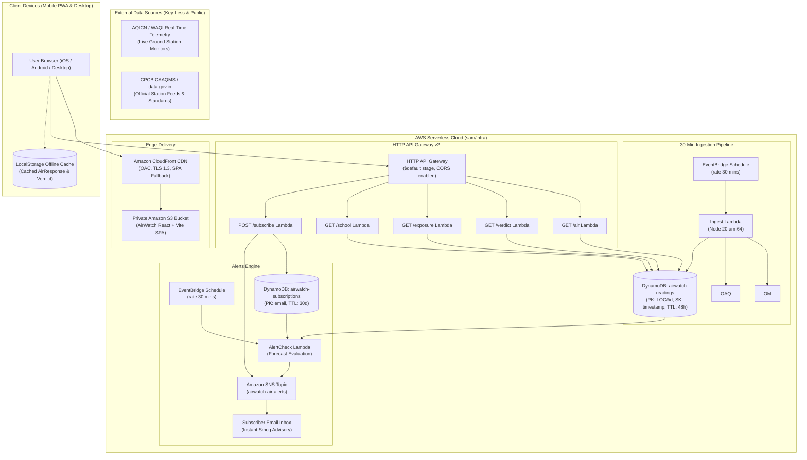

# AirWatch — System Architecture

## Architecture Overview

AirWatch is engineered as a 100% serverless, zero-maintenance AWS application designed for high resilience during peak air emergency days across Delhi NCR.

---

## Component Deep Dive

### 1. Ingestion & Caching Strategy
- The `IngestFunction` runs every 30 minutes via an EventBridge rule.
- It polls live AQICN & CPCB telemetry for the core NCR monitoring stations:
  - Anand Vihar, Ghaziabad, Noida, ITO, Dwarka, Gurugram, Rohini, and Faridabad.
- Stores hourly arrays in `airwatch-readings` with a 48-hour DynamoDB Time-To-Live (TTL).
- If a client requests custom coordinates outside the 8 presets, the `AirFunction` performs a fast live lookup and caches the geohash tile.

### 2. Decision Logic Execution
- The frontend calls `/verdict?lat=&lon=&persona=`.
- The decision engine implements deterministic, transparent heuristics:
  - **Diurnal Best Window**: Evaluates 3-hour sliding windows between 06:00 and 21:00 IST to find the lowest average PM2.5.
  - **Avoid Hours**: Identifies the 3 highest particulate hours (typical nocturnal thermal inversion peaks).
  - **Persona Thresholds**: Parent, sensitive, and commuter profiles produce tailored go/no-go recommendations.

### 3. Cumulative Particulate Exposure
- The `/exposure` endpoint calculates:
  $$\text{Dose} = \text{Average Daytime PM}_{2.5} \times \text{Hours Outside}$$
- Compares against the Indian 24-hour National Ambient Air Quality Standard ($60\,\mu\text{g}/\text{m}^3 \times 24\,\text{h} = 1,440\,\mu\text{g}\cdot\text{h}/\text{m}^3$).
- Returns dosage percentage and categorization (`within`, `near`, `over`).

### 4. Alerting via Amazon SNS
- Subscribers configure an email and AQI threshold (e.g., 200).
- Handled by `SubscribeFunction`:
  - Enrolls user into DynamoDB.
  - Triggers an AWS SNS subscription request, generating an official AWS verification email.
- `AlertCheckFunction` scans active subscribers every 30 minutes and dispatches advisories when tomorrow's forecast enters hazardous thresholds.
